# Tarea 1 — Sistemas recomendadores de recetas

**Curso:** IIC3633 Sistemas Recomendadores, 2026-2

**Equipo:** Grupo 18 (eight nine)

**Integrantes:** Jorge Cartagena, Santiago Valenzuela

## Resumen

Se analizaron 157.108 interacciones de entrenamiento entre 4.594 usuarios y
7.047 recetas, además de 27.416 interacciones de validación. La densidad de
entrenamiento es apenas 0,4853 %, las evaluaciones están fuertemente sesgadas
hacia 4 y 5 (93,92 %) y existe una cola larga de actividad. El split no es un
corte temporal global, pero sí respeta el orden por usuario: para los 4.437
usuarios de validación, ninguna primera fecha de validación antecede a su última
fecha de entrenamiento. Tampoco existen usuarios, recetas o pares repetidos
entre particiones.

Entre los tres métodos obligatorios de predicción explícita, FunkSVD obtuvo el
menor RMSE y MAE: 0,8841 y 0,4813. BaselineOnly alcanzó un RMSE levemente menor
(0,8818), lo que muestra que los sesgos de usuario e ítem explican gran parte de
la señal; aun así, FunkSVD consiguió mejor MAE. En ranking Top-10 con hasta 100
negativos muestreados por usuario, MostPopular obtuvo el mayor nDCG@10 (0,3158),
seguido muy de cerca por ALS implícito (0,3110). BPR alcanzó 0,1865 y el mejor
Content-Based, TF-IDF binario de ingredientes, 0,1354. La fortaleza de
popularidad es coherente con la concentración del EDA y no debe extrapolarse a
catálogo completo.

El principal hallazgo metodológico es que optimizar ratings no equivale a
optimizar ranking. Para ItemKNN, MSD con k=80 minimiza RMSE (0,9108), pero
Pearson con k=10 maximiza nDCG@10 dentro de la familia (0,1236 frente a 0,0574).
Esa aparente ventaja de Pearson es frágil: 70,1 % de sus candidatos recurre al
fallback y 93,6 % de los usuarios presenta empate en la frontera del Top-10.
Para FunkSVD también cambia la selección: regularización 0,05 minimiza RMSE,
mientras 0,02 maximiza nDCG. Por tanto, el objetivo de selección debe declararse
y los diagnósticos de empate/fallback deben acompañar las métricas.

## 1. Datos y análisis exploratorio

### 1.1 Particiones, cobertura y temporalidad

La densidad se calculó como

$$
\operatorname{densidad}(R)=\frac{|R|}{|U|\,|I|}.
$$

| Estadística | Entrenamiento | Validación |
| --- | ---: | ---: |
| Interacciones / pares únicos | 157.108 | 27.416 |
| Usuarios | 4.594 | 4.437 |
| Recetas | 7.047 | 6.064 |
| Densidad en el universo propio | 0,4853 % | 0,1019 % |
| Densidad usando el universo de train | 0,4853 % | 0,0847 % |
| Rating medio | 4,6601 | 4,6371 |
| Ratings 4 o 5 | 93,92 % | 93,54 % |
| Fechas | 2001-04-18 a 2018-05-14 | 2002-04-10 a 2018-07-28 |
| Celdas faltantes / pares duplicados | 0 / 0 | 0 / 0 |

Todos los usuarios y recetas de validación aparecen en entrenamiento y no hay
pares usuario–receta compartidos. Aunque los rangos de fechas se solapan
globalmente, el orden temporal individual se conserva: los 4.437 usuarios
compartidos satisfacen
$\min(t_{u,\mathrm{val}})\geq\max(t_{u,\mathrm{train}})$. En 434 casos la
frontera cae en el mismo día, de modo que con resolución diaria no es posible
determinar el orden intradía. La formulación precisa es entonces **split temporal
por usuario a resolución de día**, no corte temporal global.

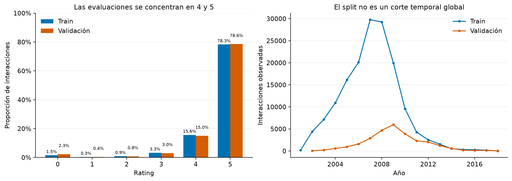

El panel izquierdo muestra que la información explícitamente negativa es
escasa. Usar rating mayor o igual a 4 como relevancia es natural para la escala,
pero deja 93,54 % de las observaciones de validación como positivas. Esto vuelve
especialmente importante conservar también los ítems de validación no relevantes
en el conjunto de candidatos y declarar el umbral.

### 1.2 Actividad, popularidad y cola larga

En entrenamiento, cada usuario posee al menos 10 interacciones por construcción
del dataset. La media es 34,20, la mediana 19 y el máximo 1.082. Para recetas, la
media es 22,29, la mediana 15 y el máximo 524. El 10 % superior de usuarios
concentra 41,22 % de las interacciones y el 10 % superior de recetas, 33,94 %.

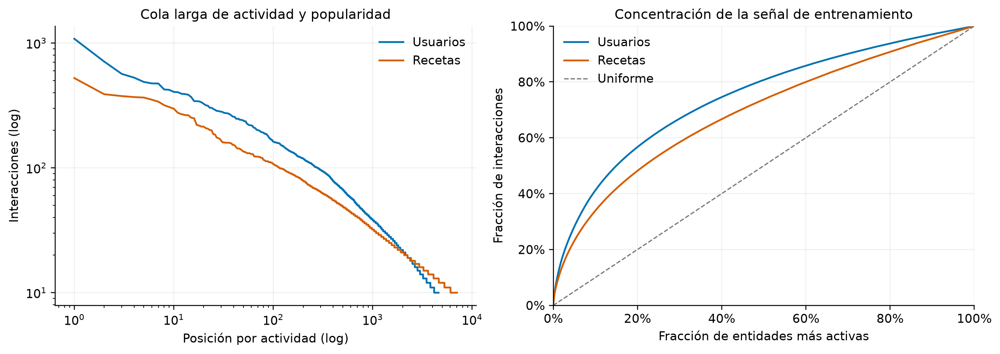

La brecha respecto de la diagonal uniforme justifica incluir MostPopular: existe
una señal de frecuencia fuerte. También anticipa dos limitaciones. KNN encontrará
menos vecinos confiables en la cola, y los factores latentes necesitarán
regularización para no ajustar ruido en entidades con menos evidencia.

### 1.3 Metadata y decisiones de representación

La metadata cubre las 7.047 recetas sin IDs duplicados. Solo la descripción
presenta faltantes: 143 filas (2,03 %). Se encontraron 3.869 ingredientes
distintos, de los cuales 1.548 aparecen en una sola receta y 2.655 en menos de
cinco. Con frecuencia documental mínima 5 quedan 1.214 ingredientes: 95,76 % de
las recetas conserva al menos tres rasgos y solo 9 queda sin ninguno. Esto
justifica incluir `min_df=5` como alternativa compacta, pero se conservan también
1 y 10 en la comparación para no decidir la poda únicamente desde cobertura.

La variable de preparación tiene mediana de 35 minutos, pero también 16 ceros,
54 valores sobre un día y un máximo de 2.147.483.647. Cualquier método que use
este atributo debe tratarlo como dato anómalo antes de escalarlo; por ejemplo,
marcando faltantes y aplicando truncamiento más transformación logarítmica.

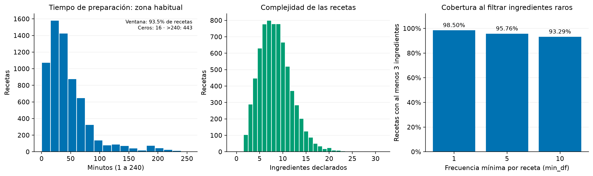

## 2. Métodos

### 2.1 Baselines

**Random** asigna un score uniforme reproducible por par usuario–receta mediante
una función hash con semilla 42. Así el resultado no depende del orden de las
llamadas.

**MostPopular** ordena por cantidad de interacciones en train, usando cualquier
rating como señal de popularidad. Es un baseline fuerte dada la concentración
observada, pero se espera menor novedad.

**BestRated** usa la media no regularizada por receta. Se incluye como diagnóstico
adicional; su debilidad es que puede favorecer ítems con poco soporte.

**BaselineOnly** estima media global y sesgos de usuario e ítem. Surprise puede
ajustar esos sesgos mediante un procedimiento ALS, pero este modelo no contiene
factores latentes y **no corresponde al ALS de feedback implícito solicitado**.

### 2.2 Filtrado colaborativo por vecinos

UserKNN e ItemKNN usan KNNBasic. En forma genérica,

$$
\hat r_{ui}=
\frac{\sum_{v\in N_i^k(u)}\operatorname{sim}(u,v)r_{vi}}
{\sum_{v\in N_i^k(u)}\operatorname{sim}(u,v)},
$$

con la versión análoga al intercambiar usuarios e ítems. UserKNN compara Pearson
y MSD para k en {5, 10, 30, 50, 70, 100}; ItemKNN compara ambas similitudes para
k en {10, 30, 50, 80}, con min_k=1.

En KNNBasic, k es un máximo y solo se agregan vecinos con similitud positiva.
Por eso se registran los vecinos efectivos (actual_k) y la fracción de fallback.
Sin esos diagnósticos, una curva plana podría interpretarse erróneamente como
evidencia de que 80 vecinos fueron realmente utilizados.

### 2.3 FunkSVD

FunkSVD aproxima el rating mediante

$$
\hat r_{ui}=\mu+b_u+b_i+q_i^\top p_u
$$

y minimiza error cuadrático regularizado con descenso de gradiente estocástico.
Se probaron 20, 50 y 100 factores; tasas 0,003 y 0,005; regularizaciones 0,02 y
0,05; 30 épocas, sesgos activados y semilla 42. Su objetivo de entrenamiento es
error de rating, no una pérdida Top-10.

### 2.4 Modelos de feedback implícito

**ALS implícito** factoriza una matriz usuario–receta de preferencias binarias.
Se usa $p_{ui}=1$ cuando el rating de entrenamiento es al menos 4 y 0 en otro
caso, con confianza $c_{ui}=1+\alpha p_{ui}$. El objetivo alternante es

$$
\min_{X,Y}\sum_{u,i}c_{ui}(p_{ui}-x_u^\top y_i)^2
+\lambda(\|X\|^2+\|Y\|^2).
$$

Se comparan 20, 50 y 100 factores, regularización 0,01 y 0,1, $\alpha=40$, 20
iteraciones y semilla 42. Esta implementación es distinta de BaselineOnly.

**BPR** usa la misma definición de interacción positiva y
aprende que un ítem observado i debe puntuar sobre uno no observado j:

$$
\max_\Theta \sum_{(u,i,j)}\log \sigma
(\hat x_{ui}-\hat x_{uj})-\lambda\|\Theta\|^2.
$$

Se comparan 20, 50 y 100 factores, manteniendo tasa 0,05, regularización 0,01,
50 iteraciones, semilla 42 y un hilo. Los scores de ambos modelos implícitos no
están calibrados como ratings, por lo que no se informan RMSE ni MAE.

### 2.5 Content-Based

Se evaluaron dos representaciones normalizadas: TF-IDF sobre listas de
ingredientes con `min_df` en {1, 5, 10}, y los embeddings BERT de 768 dimensiones
provistos junto al dataset. El perfil de cada usuario se construye solo con sus
recetas de entrenamiento relevantes y se normaliza; el score es su similitud
coseno con cada candidato. Se compararon perfiles binarios y perfiles donde un
rating 4 pesa 1 y un rating 5 pesa 2. El mejor modelo se elige por nDCG@10.

DeepFM es una extensión opcional y tampoco se mezcla con la tabla principal
mientras sus outputs no sean comparables candidato a candidato.

## 3. Protocolo de evaluación

Todos los métodos se entrenan con train completo. La selección de
hiperparámetros y la medición se realizan sobre validation, por lo que los
resultados son de desarrollo y no una estimación sobre test independiente.

Para RMSE y MAE se usan únicamente los 27.416 ratings reales. El score crudo se
recorta a [0, 5] solo para interpretar la predicción como rating.

Para ranking se construye, por cada usuario, un conjunto con:

1. todas sus observaciones de validación, incluso ratings menores que 4; y
2. hasta 100 recetas del catálogo de train que no aparezcan en su train ni en
   sus demás observaciones de validación.

Los ítems no observados se tratan como no relevantes únicamente para esta
evaluación offline; no son rechazos comprobados. El muestreo usa NumPy con
semilla 42, usuarios y catálogo ordenados, sin reemplazo. Todos los modelos
comparten el hash de candidatos
`22d8fdfe9f87ae72b93c3379f56f6fb6738babcc4df95b61b76e58982a404743`.

Los scores se ordenan crudos, sin saturarlos en 0–5. Los empates se resuelven por
recipe_id ascendente y nunca por la etiqueta real o por insertar primero los
positivos. Esto elimina el sesgo de desempate que podía favorecer artificialmente
los ítems de validación.

Las métricas de exactitud se promedian entre usuarios con al menos un relevante:

$$
\operatorname{Precision@k}_u=\frac{|L_u^k\cap G_u|}{k},\qquad
\operatorname{Recall@k}_u=\frac{|L_u^k\cap G_u|}{|G_u|}.
$$

nDCG descuenta los aciertos por posición y MAP promedia la precisión en las
posiciones relevantes, normalizada por min(k, |G_u|). Las métricas más allá de
exactitud usan todos los usuarios:

- **NoveltyBitsPerItem:** media de $-\log_2 p(i)$ por recomendación.
- **NoveltyBitsPerList:** suma por Top-10 y luego promedio entre usuarios, que es
  la normalización mostrada por el enunciado.
- **TagDiversity:** número de tags distintos en la unión del Top-10.
- **InteractionILD:** media de 1 menos similitud coseno entre perfiles binarios
  item–usuario.
- **CatalogCoverage:** ítems recomendados distintos dividido por las 7.047
  recetas de train.

La evaluación debe nombrarse **Top-10 con hasta 100 negativos muestreados**.
Cambiar el muestreo puede cambiar valores e incluso el orden relativo de
métodos; el modo de catálogo completo está disponible, pero no se usó en estas
cifras.

## 4. Resultados

### 4.1 Predicción de ratings

| Método | Configuración seleccionada | RMSE ↓ | MAE ↓ |
| --- | --- | ---: | ---: |
| BaselineOnly | sesgos global/usuario/ítem | **0,8818** | 0,4857 |
| BestRated | media no regularizada por receta | 0,9210 | 0,5255 |
| UserKNN | MSD, k=100, min_k=1 | 0,9366 | 0,5070 |
| ItemKNN | MSD, k=80, min_k=1 | 0,9108 | 0,4852 |
| FunkSVD | 20 factores, lr=0,003, reg=0,05 | 0,8841 | **0,4813** |

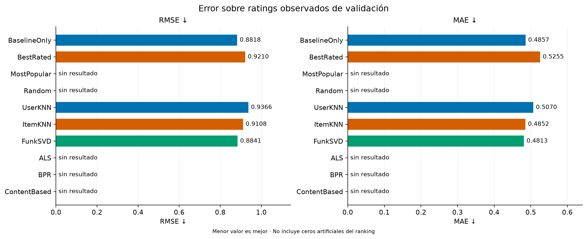

Entre los tres métodos exigidos para predicción, FunkSVD reduce el RMSE de
ItemKNN en 2,94 % y el de UserKNN en 5,61 %. BaselineOnly obtiene 0,25 % menos
RMSE que FunkSVD, pero FunkSVD reduce su MAE en 0,90 %. La diferencia entre
ambas métricas sugiere que los factores latentes mejoran el error típico, aunque
BaselineOnly controla mejor algunos errores grandes. No se afirma significancia
estadística porque todas las decisiones se tomaron sobre esta misma validación.

### 4.2 Ranking Top-10

La tabla usa la configuración elegida por menor RMSE para UserKNN, ItemKNN y
FunkSVD. Esto hace explícita una política común, pero no representa el máximo
posible de nDCG de cada familia.

| Método | Precision@10 ↑ | Recall@10 ↑ | nDCG@10 ↑ | MAP@10 ↑ |
| --- | ---: | ---: | ---: | ---: |
| BaselineOnly | 0,0688 | 0,1318 | 0,1097 | 0,0542 |
| BestRated | 0,0353 | 0,0570 | 0,0466 | 0,0197 |
| MostPopular | **0,1701** | **0,3545** | **0,3158** | **0,2033** |
| Random | 0,0500 | 0,0932 | 0,0752 | 0,0345 |
| UserKNN | 0,0340 | 0,0631 | 0,0539 | 0,0257 |
| ItemKNN (MSD, k=80) | 0,0357 | 0,0713 | 0,0574 | 0,0282 |
| FunkSVD | 0,0615 | 0,1156 | 0,0932 | 0,0436 |
| ALS implícito | 0,1657 | 0,3450 | 0,3110 | 0,1998 |
| BPR | 0,1107 | 0,2227 | 0,1865 | 0,1039 |
| Content-Based | 0,0840 | 0,1658 | 0,1354 | 0,0697 |

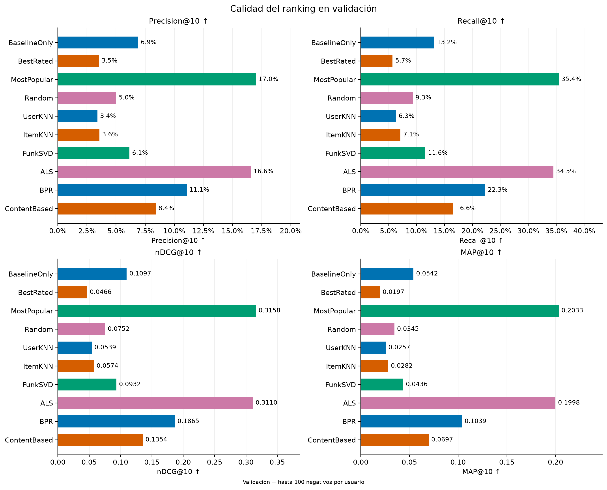

MostPopular domina las cuatro métricas, pero ALS queda a solo 0,0048 puntos de
nDCG@10 y 0,0095 de Recall@10. Luego aparecen BPR y Content-Based. El EDA ofrece
una explicación concreta: el 10 % de recetas más populares concentra 33,94 % de
train. El resultado no demuestra que popularidad sea universalmente mejor; el
muestreo de 100 negativos facilita reencontrar ítems de cabeza.

En un bootstrap pareado de 5.000 remuestras sobre los 4.391 usuarios con al
menos un relevante, la diferencia ALS menos MostPopular en nDCG@10 es −0,0048,
con intervalo percentil 95 % [−0,0118; 0,0023]. El intervalo incluye cero, por lo
que el orden observado en nDCG no queda resuelto por esta incertidumbre entre
usuarios. En Recall@10, la diferencia es −0,0095 [−0,0184; −0,0006]. Estos
intervalos condicionan modelos, candidatos e hiperparámetros ya seleccionados;
no incorporan variación entre semillas ni el sesgo de seleccionar en validation.

La comparación también confirma que el mejor predictor de ratings no es el
mejor rankeador. FunkSVD es el mejor de los tres métodos de rating, pero queda
bajo ALS, BPR, Content-Based y MostPopular en Top-10. ItemKNN seleccionado por
RMSE cae incluso bajo Random en nDCG. La sección de sensibilidad muestra que
esta última conclusión corresponde a **esa configuración**, no a toda la
familia ItemKNN.

### 4.3 Novedad, cobertura y diversidad

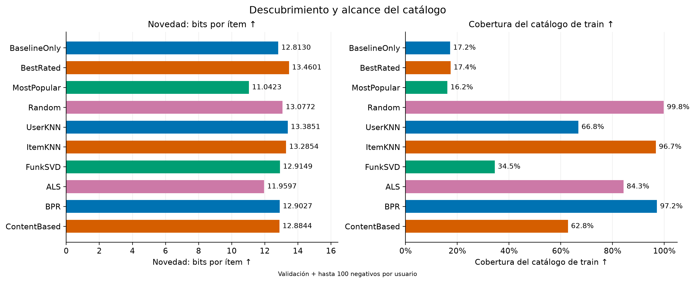

En ambos paneles, la flecha ↑ indica que un valor mayor representa más novedad
o cobertura.

MostPopular obtiene la menor novedad (11,04 bits por ítem) y solo 16,16 % de
cobertura, coherente con recomendar la cabeza. ItemKNN y BPR cubren 96,71 % y
97,18 % bajo el muestreo; ALS cubre 84,26 %, Content-Based 62,78 % y Random
99,80 %. Esta cobertura es condicional: a lo largo de miles de muestras
aleatorias casi todo el catálogo puede aparecer, aunque cada usuario solo vea
alrededor de 106 candidatos.

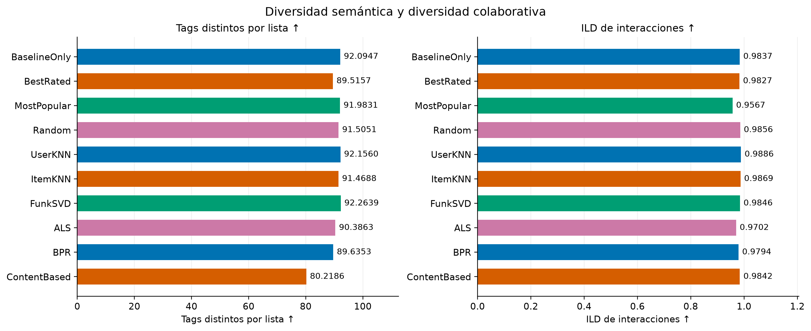

En ambos paneles, la flecha ↑ indica mayor diversidad.

Los Top-10 contienen alrededor de 80–92 tags distintos y la ILD se concentra
entre 0,957 y 0,989. El conteo tan alto revela que tags mezcla cocina, dieta,
tiempo y otras etiquetas; por eso se reporta como diversidad semántica amplia y
no como “estilos culinarios”. Las diferencias pequeñas de ILD tampoco sostienen
por sí solas una preferencia práctica. Si el informe final exige estilos, debe
definirse una taxonomía antes de recalcular.

## 5. Sensibilidad y hallazgos de los modelos

### 5.1 ItemKNN: k solicitado no es k efectivo

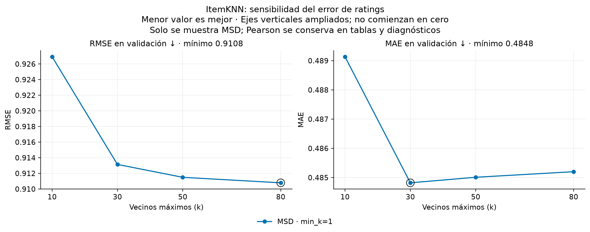

Para facilitar la lectura, la figura muestra solo MSD, la similitud que domina
RMSE y MAE. Pearson permanece en las tablas de sensibilidad y en el diagnóstico
de vecinos y fallback, donde ayuda a explicar su fragilidad.

MSD domina a Pearson en RMSE y MAE para todo k probado. Con MSD, aumentar k de
10 a 80 reduce RMSE de 0,9269 a 0,9108 (1,74 %), pero casi toda la ganancia
ocurre hasta k=30. MAE alcanza su mínimo en k=30 (0,4848) y sube levemente a
0,4852 en k=80. Por tanto, k=80 gana por RMSE, no de manera universal.

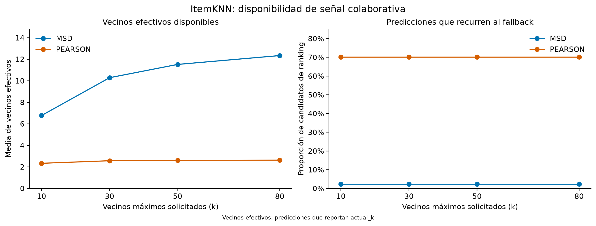

La explicación está en la señal disponible. Para MSD, la media de actual_k sube
de 6,77 con k=10 a solo 12,34 con k=80 y la mediana permanece en 7. Solicitar 80
vecinos no implica agregarlos. Con Pearson la media queda entre 2,33 y 2,63 y
70,11 % de los candidatos recurre al fallback, por lo que aumentar k casi no
cambia las predicciones.

El objetivo de ranking cuenta otra historia:

| Selección ItemKNN | RMSE ↓ | nDCG@10 ↑ | Fallback | Empate en k=10 |
| --- | ---: | ---: | ---: | ---: |
| Mejor RMSE: MSD, k=80 | **0,9108** | 0,0574 | 2,33 % | 65,09 % |
| Mejor nDCG: Pearson, k=10 | 0,9974 | **0,1236** | 70,11 % | 93,64 % |

Pearson mejora nDCG dentro de la familia, pero depende de fallback y empates
masivos. El desempate actual es determinista y no mira relevancia, de modo que
el valor es reproducible; aun así, no es evidencia de un ranking robusto. Antes
de recomendar Pearson conviene aumentar min_k, comparar pearson_baseline,
reducir empates o validar en catálogo completo.

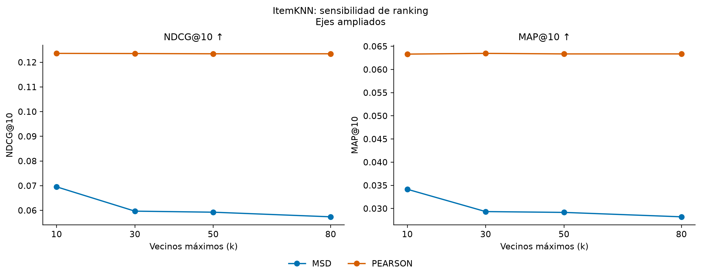

### 5.2 FunkSVD: capacidad y regularización

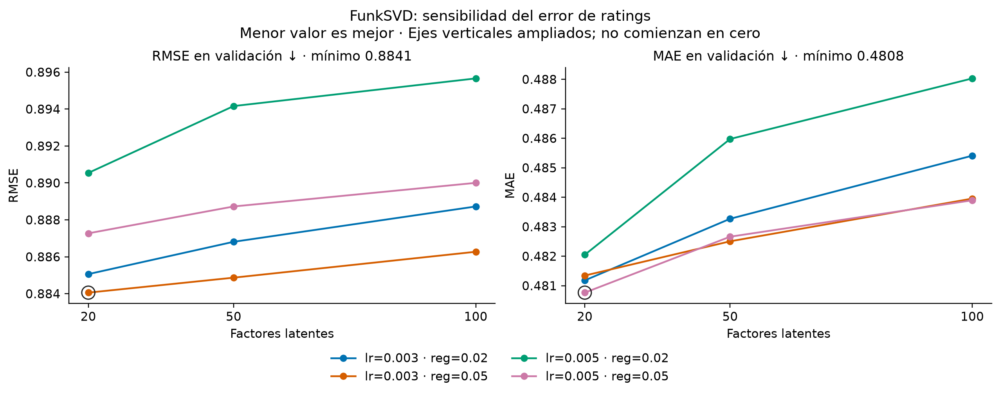

Veinte factores obtiene el menor RMSE en las cuatro combinaciones de tasa y
regularización. Aumentar a 50 o 100 factores empeora de forma consistente, lo
que sugiere que la capacidad adicional no compensa la dispersión. La
configuración 20/0,003/0,05 minimiza RMSE (0,8841); 20/0,005/0,05 minimiza MAE
(0,4808). Otra vez, la elección depende de la métrica.

Para ranking, 20/0,003/0,02 maximiza nDCG@10 en 0,0971, frente a 0,0932 de la
selección por RMSE. La menor regularización conserva más diferencias entre
scores y mejora 4,15 % el nDCG relativo, a costa de aumentar RMSE a 0,8851.
La configuración seleccionada produce 8,57 % de scores fuera de [0, 5]; mantener
el score crudo para ordenar evita convertirlos en empates por saturación. No se
observan empates exactos en la frontera Top-10 de FunkSVD.

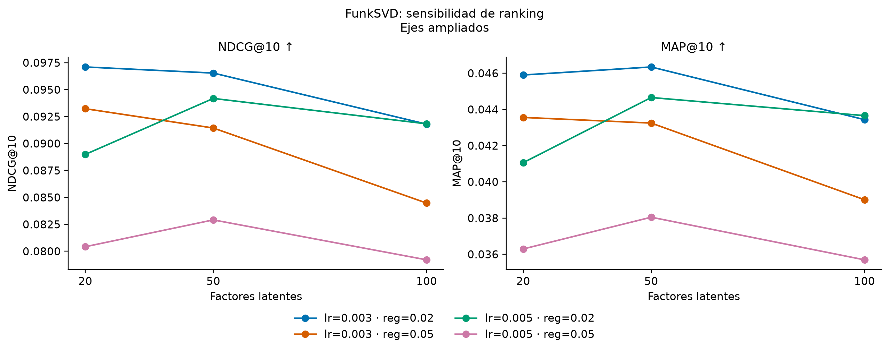

### 5.3 ALS y BPR: el número de factores no tiene un efecto común

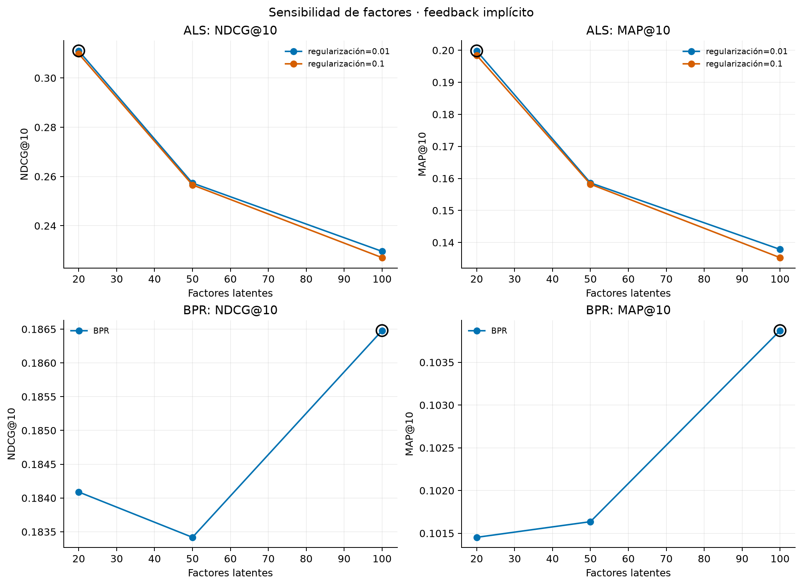

ALS alcanza su mayor nDCG@10 con 20 factores y regularización 0,01 (0,3110).
Subir a 50 y 100 factores lo reduce a 0,2573 y 0,2296. La regularización 0,1
produce curvas casi idénticas: incluso obtiene un Recall apenas mayor con 20
factores, pero menor nDCG y MAP. Esto apunta a que, para la señal escasa y
binarizada, aumentar capacidad perjudica la posición de los relevantes.

BPR muestra diferencias mucho menores: nDCG@10 varía entre 0,1834 y 0,1865.
La selección de 100 factores es el máximo observado, no evidencia de una mejora
estadísticamente estable. ALS y BPR reaccionan de forma distinta a la dimensión,
por lo que no corresponde trasladar automáticamente el mejor tamaño de uno al
otro.

### 5.4 Content-Based: los ingredientes superan a BERT

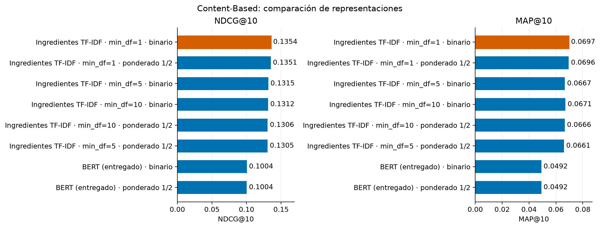

El mejor Content-Based usa los 3.869 ingredientes TF-IDF sin poda y perfiles
binarios: nDCG@10 0,1354 y MAP@10 0,0697. Con `min_df=5` quedan 1.214 dimensiones
y nDCG baja a 0,1315; con `min_df=10`, 713 dimensiones y 0,1312. La poda mejora
compactación con una pérdida pequeña, pero no gana calidad en esta validación.

Los embeddings BERT entregados alcanzan cerca de 0,1004 nDCG, 0,0350 puntos por
debajo del mejor TF-IDF. Una explicación plausible es que la coincidencia fina
de ingredientes se alinea mejor con el gusto observable que una representación
semántica general de la receta. Los perfiles binarios superan apenas a los
ponderados por rating en todas las representaciones; dada la diferencia mínima,
no se interpreta como un efecto concluyente.

## 6. Conclusiones

El EDA describe un problema muy disperso, con ratings concentrados en valores
altos y una cabeza de popularidad fuerte. Esas propiedades explican tanto la
ventaja de modelos compactos —20 factores en FunkSVD y ALS— como la competitividad
de MostPopular. En predicción explícita, FunkSVD es el mejor de los tres métodos
obligatorios; en ranking, MostPopular supera por un margen estrecho a ALS y ambos
quedan claramente sobre BPR.

La personalización no garantiza una mejora bajo este protocolo: depende de la
señal, el objetivo de entrenamiento y los candidatos. Content-Based confirma
que la metadata sí es informativa, especialmente los ingredientes sin poda,
pero no alcanza a los modelos implícitos. El resultado de BERT muestra además
que una representación semántica más compleja no necesariamente se alinea con
la relevancia definida por ratings.

La recomendación práctica es separar el modelo según el objetivo: FunkSVD para
estimar ratings; MostPopular como baseline difícil de superar y ALS como opción
personalizada competitiva para Top-10. Estas conclusiones son de desarrollo y
condicionales a 100 negativos muestreados; no constituyen evidencia sobre un
test independiente ni sobre ranking de catálogo completo.

## Referencias

- B. Sarwar et al., [*Item-Based Collaborative Filtering Recommendation Algorithms*](https://compjournalism.com/files/-dmsl/sarwar_2001.pdf), WWW 2001.
- Surprise, [KNNBasic y vecinos efectivos](https://surprise.readthedocs.io/en/stable/knn_inspired.html).
- Surprise, [SVD y función de optimización](https://surprise.readthedocs.io/en/stable/matrix_factorization.html).
- Y. Hu, Y. Koren y C. Volinsky, [*Collaborative Filtering for Implicit Feedback Datasets*](https://yifanhu.net/PUB/cf.pdf), ICDM 2008.
- S. Rendle et al., [*BPR: Bayesian Personalized Ranking from Implicit Feedback*](https://www.cs.mcgill.ca/~uai2009/papers/UAI2009_0139_48141db02b9f0b02bc7158819ebfa2c7.pdf), UAI 2009.
- M. Pazzani y D. Billsus, [*Content-Based Recommendation Systems*](https://citeseerx.ist.psu.edu/document?doi=34446adc7d701a2c3a89c2fc5f6d3479eef407b0&repid=rep1&type=pdf), 2007.
- S. Vargas y P. Castells, [*Rank and Relevance in Novelty and Diversity Metrics for Recommender Systems*](https://castells.github.io/papers/recsys2011.pdf), RecSys 2011.
- W. Krichene y S. Rendle, [*On Sampled Metrics for Item Recommendation*](https://arxiv.org/abs/1912.02263), KDD 2020.
